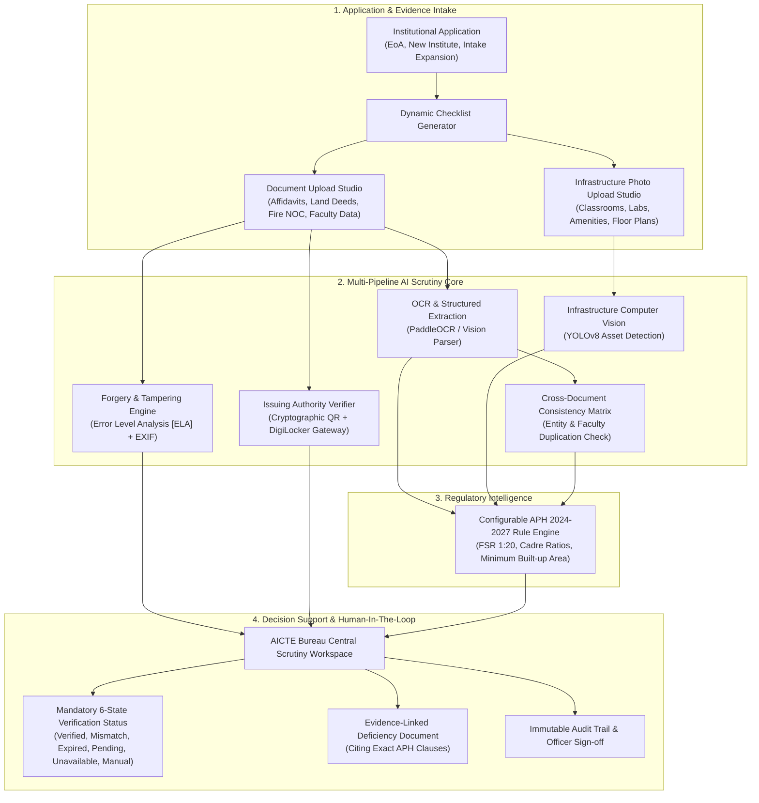

# AICTE VeriSense 🏛️🔍
### *AI-Powered Application Validation, Document Authentication & Regulatory Compliance Verification*
> **Smart India Hackathon (SIH) 2026 | Problem Statement ID: 26261**  
> **Organization:** All India Council for Technical Education (AICTE), Ministry of Education, Government of India  
> **Bureau:** Regulation Bureau | **Category:** Software | **Theme:** Smart Automation  

[](https://sih.gov.in)
[](https://sih.gov.in)
[](https://www.aicte-india.org)
[](#)

---

## 📌 Executive Summary

Every year, the All India Council for Technical Education (AICTE) processes thousands of applications submitted by technical institutions across India for **Extension of Approval (EoA)**, new campus establishments, and intake expansion in accordance with the official **AICTE Approval Process Handbook (APH 2024–2027)**. 

Manual scrutiny of high-volume documentation—such as land titles, municipal fire safety NOCs, building blueprints, faculty KYC rosters, and financial payment receipts—leads to severe administrative delays, missed document expiries, duplicate faculty listings, and unnoticed document forgery.

**AICTE VeriSense** is an integrated, explainable decision-support platform designed to automate preliminary scrutiny, verify records directly against issuing authorities, detect image tampering, and conduct computer-vision infrastructure validation—**while strictly preserving statutory scrutiny and final authority with competent AICTE officials.**

---

## 🏛️ System Architecture



---

## 🚀 Key Functional Modules (Direct PS 26261 Mapping)

### 1. Intelligent Application & Document Validation
* **Dynamic Category Checklists:** Automatically configures required documentary evidence based on the selected application category:
  * Extension of Approval (EoA)
  * Setting Up New Technical Campus
  * Increase in Approved Intake / New Courses
  * Supernumerary Seats (TFW / EWS)
  * Closure or Change of Site
* **Automated Data Extraction:** Extracts text, dates, certificate reference numbers, and table figures from uploaded PDFs and scans.
* **Pre-Submission Compliance Meter:** Gives colleges real-time feedback on missing fields or expired certificates before submission.

### 2. Anomaly & Potential Forgery Detection
* **Error Level Analysis (ELA):** Analyzes JPEG compression differences to detect digital modifications, spliced text, or altered dates.
* **EXIF & Metadata Forensics:** Flags documents created or modified in unauthorized image manipulation software (e.g., Adobe Photoshop, Canva).
* **Duplicate Document & Faculty Cross-Matching:** Cross-checks faculty PAN/Aadhaar entries against the centralized AICTE registry to catch "ghost faculty" listed simultaneously at multiple colleges.

### 3. Verification Through Original Issuing Authorities
* **Mandatory 6-State Taxonomy:** Enforces the official verification states required by AICTE:
  1. `Verified` (Cryptographically validated via QR / Registry)
  2. `Mismatch Detected` (Discrepancy found against issuing authority records)
  3. `Expired` (Document validity elapsed prior to submission)
  4. `Verification Pending` (External API query queued)
  5. `Source Unavailable` (Issuing authority API timeout or offline)
  6. `Manual Review Required` (Unresolvable anomaly routed to regional scrutiny officer)
* **Cryptographic QR Validation:** Decodes and verifies digital signature payloads on municipal certificates, building plan approvals, and e-Notary stamp papers.
* **DigiLocker / National Academic Depository (NAD) Gateway:** Federated API connectivity to fetch authentic records directly from MeitY-authorized repositories.

### 4. Regulatory & Infrastructure Compliance Assistance
* **YOLOv8 Computer Vision Inspection:** Automatically validates physical facilities from uploaded photographs:
  * Student-to-Computer terminal ratio in computer centers (Min 1:4).
  * Classroom desk and seating capacity estimation.
  * Laboratory safety equipment (fire extinguishers, first-aid).
  * Barrier-free Divyangjan accessibility (1:12 slope PWD ramps, tactile floor tiles).
* **Statutory Citations:** Every discrepancy explicitly cites the relevant clause from the AICTE Approval Process Handbook (e.g., *Clause 4.3.2 for FSR*, *Clause 5.4.1 for Fire NOC*).

### 5. Centralized Decision-Support Dashboard & Audit Trail
* **Officer Workspace:** Split-screen layout displaying original uploaded files side-by-side with extracted data, ELA heatmaps, and handbook rules.
* **Advisory Action Bar:** AICTE scrutiny officers can choose to:
  * *Endorse for Extension of Approval (EoA)*
  * *Issue 15-Day Rectification Notice*
  * *Order Physical Inspection (SAC Committee)*
* **Immutable Audit Trail:** Chronological, tamper-evident log capturing timestamps, operator IDs, rules evaluated, and regulatory outcomes.
* **Official AICTE Deficiency Report:** Generates an official, exportable PDF report formatted to government standards.

---

## 🛠️ Technology Stack

| Layer | Technologies |
| :--- | :--- |
| **Frontend** | React 18, Vite, TypeScript, Tailwind CSS, Lucide Icons, Radix UI (shadcn/ui), TanStack Query |
| **Backend & APIs** | Python FastAPI, Pydantic v2, PyMuPDF, `pyzbar`, OpenCV |
| **AI / Computer Vision** | YOLOv8 (`yolov8l.pt`), Error Level Analysis (PIL/OpenCV), Image Forensics |
| **Regulatory Engine** | Configurable APH 2024–2027 Rule Matrix + Vector-grounded RAG |
| **Security & Standards** | Role-Based Access Control (RBAC), Immutable Audit Logging, WCAG 2.1 Accessibility |

---

## ⚡ Quickstart & Local Setup

### 1. Prerequisites
* **Node.js:** v18.0.0 or higher
* **Python:** 3.10 to 3.12 (for backend CV modules)
* **Git**

### 2. Clone and Run Frontend
```bash
git clone https://github.com/LearnCodeZaid/aicte-verisense.git
cd aicte-verisense

# Install dependencies
npm install --legacy-peer-deps

# Launch the development server
npm run dev
```
Open **[http://localhost:5176](http://localhost:5176)** in your browser.

---

## 🧪 Included Demonstration Scenarios

AICTE VeriSense comes with 3 pre-configured institutional applications for instant evaluator demonstration:

1. **Pune Institute of Advanced Technology (PIAT) — PID: 1-39482910**
   * *Scenario:* Standard EoA Application with Minor Deficiencies.
   * *Flagged:* Fire Safety Certificate expired 16 days ago; FSR Cadre ratio short by 2 Assistant Professors.
   * *CV Finding:* Computer lab contains 38 terminals against 40 required.
2. **Apex Institute of Technology & Management — PID: 1-84920482**
   * *Scenario:* High-Risk Intake Expansion.
   * *Flagged:* ELA Tampering detected on Land Allotment Deed (plot numbers altered in Photoshop); 3 faculty PAN numbers duplicate with another college.
3. **Vidyavardhini College of Engineering — PID: 1-10294822**
   * *Scenario:* 100% Compliant / Clean Pass.
   * *Outcome:* All documents verified via DigiLocker and municipal QR; all infrastructure norms satisfied.

---

## ⚖️ Essential Safeguards & Statutory Disclaimer

* **Configurability:** All checks are dynamically configurable to reflect amendments to the AICTE Approval Process Handbook without code changes.
* **Privacy & Access Control:** Role-based access boundaries ensure institutions only view their own submissions, while AICTE scrutiny officers access regional queues.
* **Human-in-the-Loop:** **AI outputs are decision-support recommendations only.** Statutory scrutiny, physical inspections, and final regulatory decisions remain exclusively with competent AICTE authorities.

---

## 📄 License

This project is licensed under the MIT License - see the [LICENSE](LICENSE) file for details.
